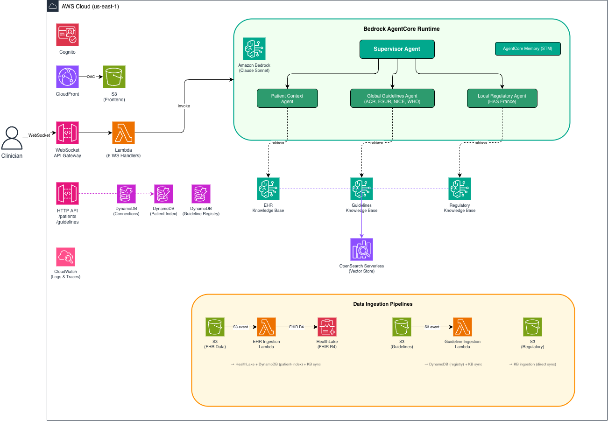

AWS ClinicalCompass is built on a serverless architecture using AWS managed services.

## System Overview



The system has three major layers: a real-time query path (WebSocket), a REST API for structured data, and data ingestion pipelines that feed the knowledge bases.

## Real-Time Query Path

The primary interaction path for clinicians uses WebSocket for streaming responses:

1. **CloudFront** serves the static frontend from S3 (OAC-secured)
2. **WebSocket API Gateway** handles real-time bidirectional communication
3. **6 Lambda handlers** manage connection lifecycle and query routing
4. **AgentCore Runtime** hosts the multi-agent system that processes clinical queries

## REST API

An HTTP API Gateway provides structured data endpoints for the frontend UI:

| Endpoint | Purpose |
|----------|---------|
| `GET /patients` | List patients for the Patient Selector dropdown |
| `GET /patients/{id}` | Retrieve specific patient context |
| `GET /guidelines` | List available guideline sources for the Guideline Selector |

These endpoints read directly from DynamoDB (patient-index and guideline-registry tables), populated by the ingestion pipelines.

## AI Processing Engine

The agentic system runs on Amazon Bedrock AgentCore:

- **Foundation model:** Claude Sonnet via Amazon Bedrock
- **Supervisor Agent** orchestrates three specialised agents in parallel
- **AgentCore Memory (STM)** maintains session context for multi-turn conversations
- **Decision traces** stored for audit compliance

See [Agents](../agents/) for detailed agent architecture.

## Knowledge Base Layer

Three Bedrock Knowledge Bases provide semantic retrieval:

| Knowledge Base | Content | Agent |
|---------------|---------|-------|
| EHR | Patient demographics, labs, medications, allergies | Patient Context Agent |
| Guidelines | ACR, ESUR, NICE, WHO clinical guidelines | Global Guidelines Agent |
| Regulatory | HAS France, NHS local trust protocols, SOPs | Local Regulatory Agent |

All KBs use:
- **Embedding:** amazon.titan-embed-text-v2:0
- **Chunking:** 512 tokens, 20% overlap
- **Vector store:** OpenSearch Serverless

## Data Ingestion Pipelines

Three separate ingestion paths feed the knowledge bases and DynamoDB:

### Patient (EHR) Pipeline

```
S3 (ehr-data) → Lambda (EHR Ingestion) → HealthLake (FHIR R4) + DynamoDB (patient-index) + KB sync
```

- Triggered by S3 upload events
- Transforms patient JSON to FHIR R4 format and stores in AWS HealthLake
- Computes section hashes for differential detection (only changed sections re-processed)
- Stores structured records in DynamoDB for direct lookups (UI Patient Selector)
- Syncs to EHR Knowledge Base for RAG retrieval (semantic search by agents)

### Guidelines Pipeline

```
S3 (guidelines) → Lambda (Guideline Ingestion) → DynamoDB (guideline-registry) + KB sync
```

- Triggered by S3 upload events
- Stores lightweight metadata in DynamoDB (source name, status) for the UI dropdown
- Full content goes to the Guidelines Knowledge Base for RAG

### Regulatory Pipeline

```
S3 (local-regulatory) → KB ingestion job (direct sync)
```

- No Lambda intermediary — documents sync directly to the Regulatory KB
- Always consulted by the Local Regulatory Agent (no user selection needed)

## Frontend

A vanilla JavaScript application served via CloudFront, using the [AG-UI protocol](https://docs.ag-ui.com/) for real-time streaming of agent events to the browser:

- **Patient Selector** — dropdown populated from DynamoDB via HTTP API
- **Guideline Selector** — choose which guideline sources to consult
- **Citation Panel** — click-through links to source documents
- **Decision Trail** — expandable reasoning trace with conflict resolution details

## Security and Compliance

- **Authentication:** Amazon Cognito (USER_PASSWORD_AUTH + USER_SRP_AUTH)
- **Frontend hosting:** CloudFront with Origin Access Control (OAC) to S3
- **Data encryption:** At rest (S3 SSE, DynamoDB encryption, OpenSearch encryption) and in transit (TLS)
- **Network:** All service-to-service communication via AWS internal endpoints
- **Observability:** ADOT tracing with clinical decision audit trail

## Infrastructure as Code

The entire stack is deployed via AWS CDK (TypeScript):

- DynamoDB tables (connections, patient-index, guideline-registry)
- 10 Lambda functions (WebSocket handlers, ingestion, API, keep-alive)
- WebSocket + HTTP API Gateways
- S3 buckets (frontend, EHR data, guidelines, regulatory, KB data x3)
- CloudFront distribution + OAC
- OpenSearch Serverless collections
- AWS HealthLake FHIR datastore (patient data in FHIR R4 format)
- Cognito User Pool
- SSM Parameter Store (resource IDs, ARNs, endpoints)
- CloudWatch Events (AgentCore keep-alive every 5 min)
